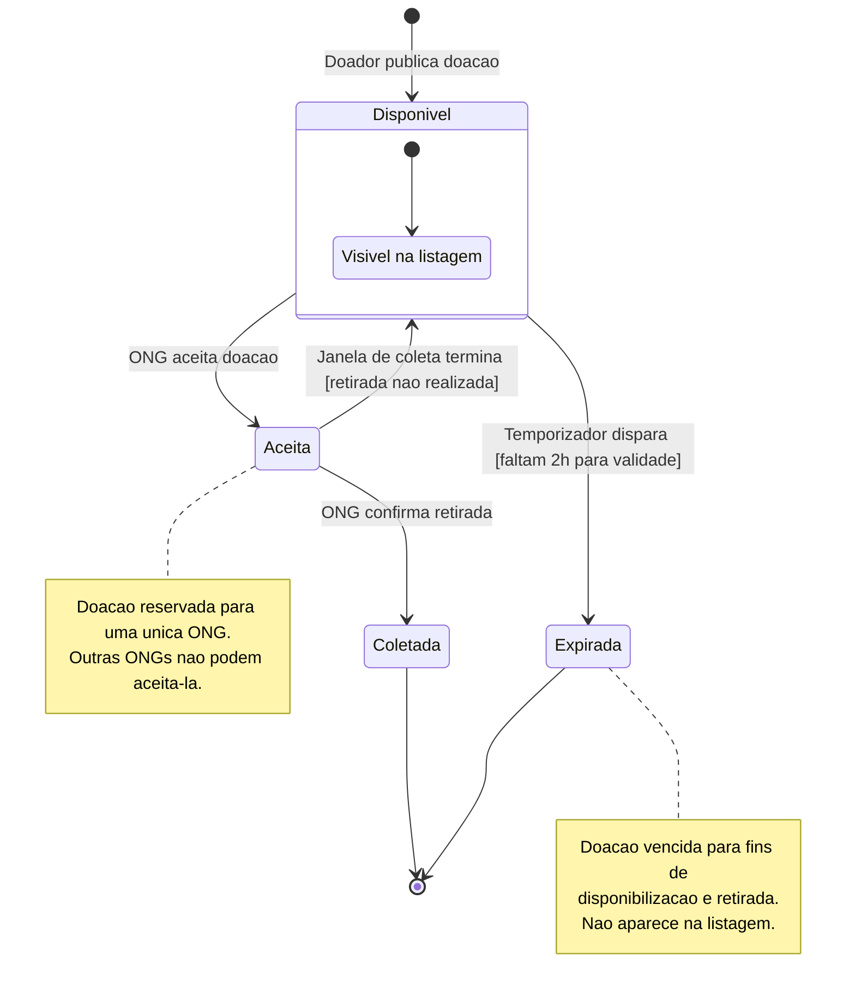
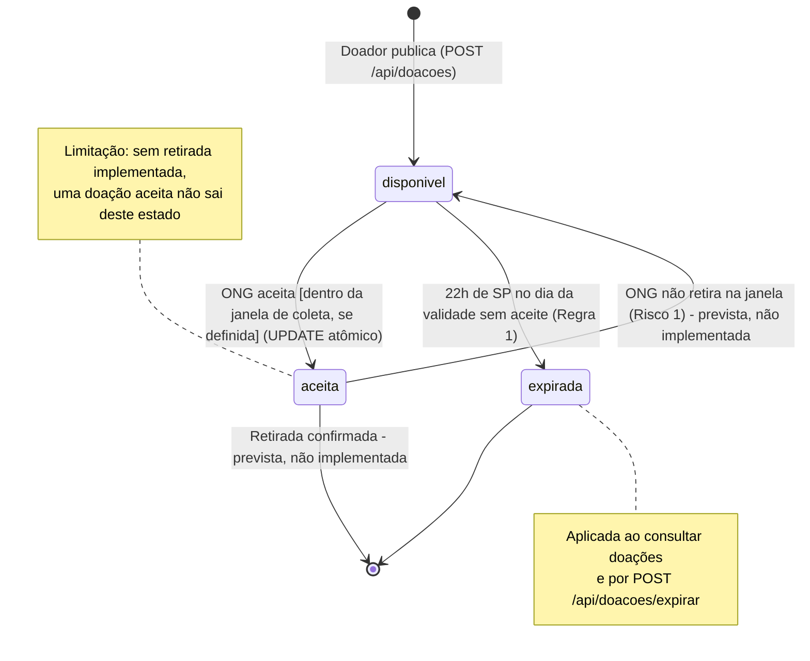

# Diagrama de Estados — Doação

## Versão gerada pela IA

**Prompt usado:**

> Estou desenvolvendo o Prato Cheio, uma plataforma que conecta doadores de alimentos (restaurantes e mercados) a ONGs.
>
> Regras:
> - O doador publica uma doação com tipo, quantidade, validade e, opcionalmente, uma janela de coleta.
> - Uma ONG pode aceitar uma doação disponível; depois de aceita, nenhuma outra ONG pode aceitá-la.
> - Doações não aceitas até 2 horas antes da validade devem ser expiradas e ocultadas da listagem.
> - Se a ONG aceitar mas não retirar dentro da janela de coleta, a doação deve voltar para a listagem.
>
> Gere um diagrama de estados da entidade Doação em Mermaid (stateDiagram-v2), com os estados e as transições, cada transição com o evento que a dispara.

**Resposta da IA (sem alterações):**

O diagrama deve representar o ciclo de vida da entidade Doação no Prato Cheio, distinguindo a disponibilidade para aceite, a reserva por uma ONG, a conclusão da coleta e a expiração por prazo.

Vou considerar que uma doação aceita fica indisponível para outras ONGs, mas pode voltar a ficar disponível se a coleta não acontecer dentro da janela definida. A expiração automática ocorre quando a doação ainda não foi aceita e faltam duas horas para o vencimento.

**Estados e regras**

| Estado | Significado |
|---|---|
| Disponivel | Doação publicada e visível para as ONGs. |
| Aceita | Uma ONG aceitou a doação; ela fica reservada exclusivamente para essa ONG. |
| Coletada | A ONG confirmou a retirada. |
| Expirada | A doação não foi aceita até o limite de duas horas antes da validade e deixa de aparecer na listagem. |

Observações importantes para a implementação:
- Aceite exclusivo: a operação de aceite deve ser atômica no banco de dados, evitando que duas ONGs aceitem a mesma doação simultaneamente.
- Expiração automática: um processo agendado deve verificar as doações disponíveis e expirará aquelas que atingirem o limite de duas horas antes da validade.
- Falha na coleta: se a janela de coleta terminar sem retirada, a doação volta a ficar disponível, desde que ainda possa ser oferecida conforme as regras de validade.
- Janela de coleta opcional: quando não houver janela definida, é necessário estabelecer uma regra alternativa para determinar quando uma doação aceita pode voltar à listagem.

O diagrama usa Coletada e Expirada como estados finais. A doação que retorna de Aceita para Disponivel pode ser aceita por outra ONG, desde que continue elegível.

## Problemas identificados

**Problema 1:** A IA tratou a janela de coleta como um prazo de retirada *depois* do aceite (transição `Aceita → Disponivel` quando a janela termina) e não colocou nenhuma condição na transição `Disponivel → Aceita`.

**Justificativa:** No Prato Cheio, a janela de coleta é definida pelo doador para resolver o conflito entre doador e ONG (`analise.md`, "Conflitos de prioridade") e, pelo critério de aceite da HU03, o aceite só é confirmado se estiver dentro dessa janela. No código, `aceitar()` em `src/doacoes.js` recusa o aceite fora da janela com o erro "aceite fora da janela de coleta definida pelo doador". A janela é uma condição para *aceitar*, não um temporizador sobre doações já aceitas.

**Correção:** A transição `disponivel → aceita` passou a ter a condição `[dentro da janela de coleta, se definida]`.

**Problema 2:** A expiração foi modelada como um "temporizador" / "processo agendado" que dispara quando faltam 2h para a validade.

**Justificativa:** A `validade` é guardada só como data (`AAAA-MM-DD`), sem hora, então "2h antes" precisou ser interpretado: o grupo definiu que a doação expira às 22h (horário de São Paulo) do dia da validade. Além disso, não existe agendador: `expirarVencidas()` em `src/repositorio.js` é executada sempre que uma doação é consultada (`GET /api/doacoes`, `GET /api/doacoes/todas` e `GET /api/doacoes/:id`) e também pela rota `POST /api/doacoes/expirar`.

**Correção:** O rótulo da transição `disponivel → expirada` passou a descrever a regra real (22h de SP no dia da validade) e quando ela é aplicada (ao consultar doações ou pela rota `/expirar`).

**Problema 3:** A IA incluiu o estado `Coletada` e a transição `Aceita → Disponivel` como se fizessem parte do sistema.

**Justificativa:** O código só tem três status: `disponivel`, `aceita` e `expirada`. Não há rota nem função para confirmar a retirada ou para devolver uma doação aceita à listagem. A própria IA admite que, sem janela definida, não há regra para essa volta. Essas transições vêm do Risco 1 (`analise.md`) e da história de acompanhamento, mas ainda não foram implementadas.

**Correção:** As duas transições foram mantidas na versão final, porque representam o comportamento desejado, mas marcadas como *previstas, não implementadas*, para o diagrama não descrever algo que o sistema ainda não faz.

**Problema 4:** No diagrama da IA, uma doação `Aceita` só sai desse estado por coleta ou pela volta para `Disponivel`; não há caminho para quando a validade passa com a doação ainda reservada.

**Justificativa:** É exatamente o cenário do Risco 1: o alimento "vence reservado" sem chegar a ninguém. No código atual, `expirarVencidas()` só expira doações com status `disponivel`, então uma doação aceita e não retirada fica como `aceita` para sempre.

**Correção:** Registrado como limitação na nota do estado `aceita` na versão final. Resolver exige implementar a confirmação de retirada (Problema 3).

## Versão final corrigida

## Reflexão

**Qual diagrama foi mais útil para questionar uma decisão? Por quê?**

O diagrama de estados. Ao desenhar cada transição com o evento que a dispara, ficou visível que duas setas do diagrama (`aceita → disponivel` e a retirada confirmada) não têm nenhum código por trás: uma doação aceita hoje não sai mais desse estado. Isso levou o grupo a questionar se a entrega cobria o Risco 1 de fato e a separar o que está implementado do que é só planejado. Também foi o diagrama de estados que expôs a ambiguidade de "2 horas antes da validade" quando a validade é só uma data, o que obrigou o grupo a decidir e documentar a regra das 22h de São Paulo.
