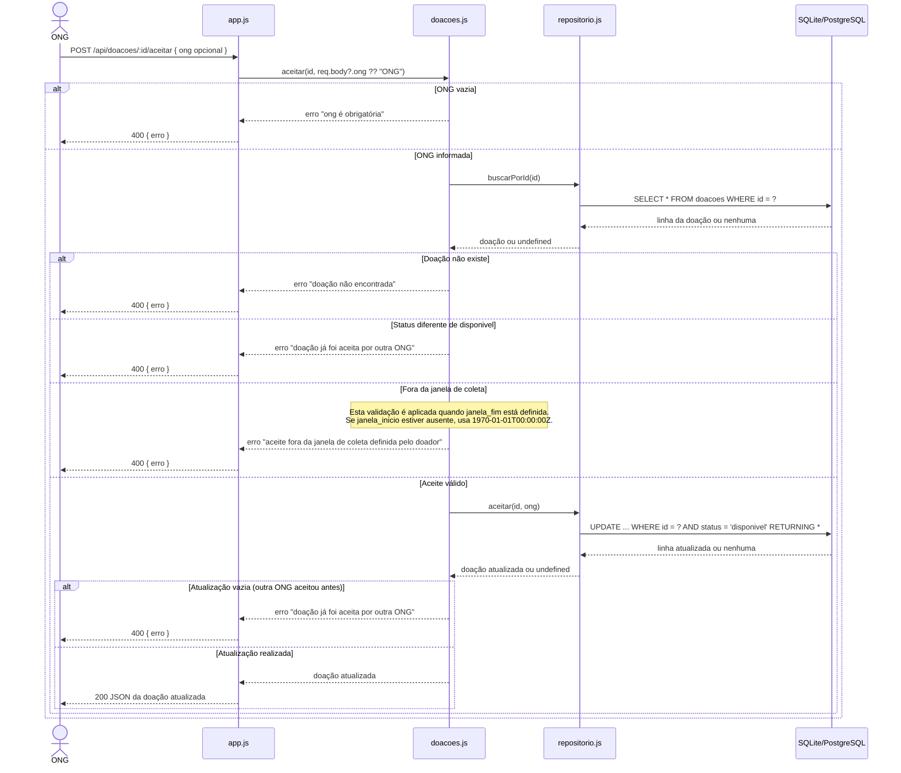

# Diagrama de Sequência — Aceite de Doação

O diagrama mostra o caminho de uma ONG ao tentar aceitar uma doação, desde a requisição HTTP até a atualização no banco de dados.

## Fluxo de aceite

## Como ler o fluxo

1. A rota recebe o ID da doação e a ONG. Se `ong` não for enviada, a API usa `"ONG"` como valor padrão.
2. A regra de negócio busca a doação e recusa o aceite se ela não existir, já tiver outro status ou estiver fora da janela definida.
3. O repositório atualiza o status para `aceita` e registra a ONG somente se a doação ainda estiver `disponivel`. Essa condição no `UPDATE` impede que duas ONGs concluam o aceite da mesma doação.
4. A API devolve a doação atualizada com HTTP 200; erros de validação são devolvidos com HTTP 400.

## Limitação desta versão

Este diagrama representa a lógica da branch `feat/logica-janela-coleta`. Embora exista uma operação `expirarVencidas()`, ela ainda não é chamada antes do aceite nesta versão. Portanto, o fluxo não verifica nem expira uma doação vencida antes de tentar aceitá-la.
