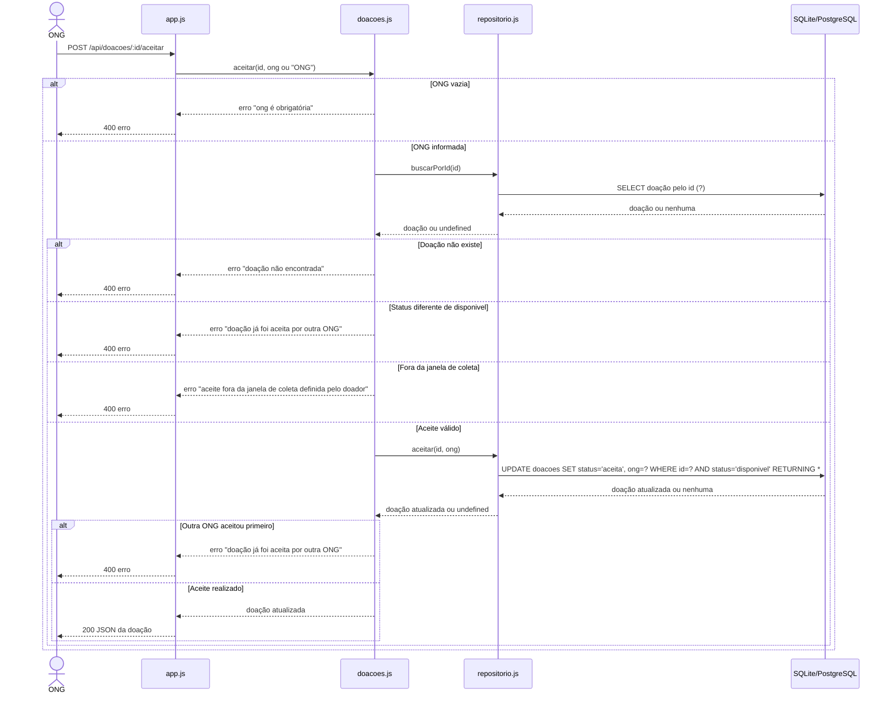
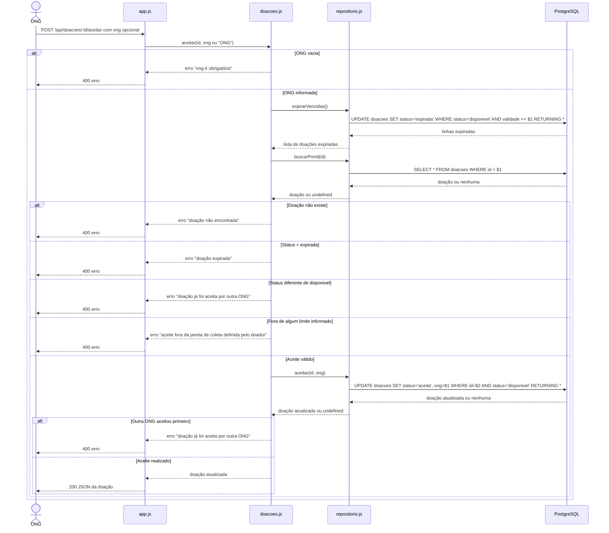

# Diagrama de Sequência — Aceite de Doação

## Versão inicial

**Ferramenta usada para gerar o diagrama:** não identificada no PR #11. O SVG original informa PlantUML 1.2026.8, que é o renderizador, não necessariamente a ferramenta de IA.

**Prompt usado:** não registrado no repositório.

**Diagrama original, transcrito para Mermaid:**

Na versão inicial, a janela só era validada quando `janela_fim` estava definida; sem `janela_inicio`, o domínio usava `1970-01-01T00:00:00Z`.

## Problemas identificados

**Problema 1:** O diagrama inicial não mostra a expiração antes da busca da doação.

**Justificativa:** A validade pode ter passado sem que alguém tenha consultado a listagem. Sem aplicar a expiração antes do aceite, uma doação ainda registrada como `disponivel` poderia ser aceita depois de vencida.

**Correção:** A implementação atual chama `expirarVencidas()` antes de `buscarPorId(id)` e recusa a doação se o status tiver mudado para `expirada`.

**Problema 2:** O diagrama inicial não mostra o erro específico para uma doação expirada.

**Justificativa:** Depois de aplicar a expiração, o domínio verifica `status === 'expirada'` antes da validação de disponibilidade.

**Correção:** A versão final inclui o caminho de erro `doação expirada`.

**Problema 3:** O desenho inicial não representa corretamente as validações da janela de coleta implementadas na `main`.

**Justificativa:** O início e o fim são limites opcionais e independentes. Cada limite informado é validado; não é necessário que ambos estejam definidos para a janela ser aplicada.

**Correção:** A versão final mostra a validação de cada limite informado e que os horários de início e fim são inclusivos.

**Problema 4:** O diagrama inicial mistura SQLite e PostgreSQL e usa `?` como marcador SQL.

**Justificativa:** A implementação atual usa PostgreSQL e parâmetros posicionais, como `$1` e `$2`.

**Correção:** A versão final representa PostgreSQL e os parâmetros usados nas consultas.

## Versão final corrigida

**Observações sobre as regras:** `janela_inicio` e `janela_fim` são opcionais e verificados separadamente; os limites são inclusivos. A expiração usa a data-limite calculada no fuso `America/Sao_Paulo`, às 22h, e só altera doações `disponiveis`.

## Reflexão

**O que a comparação entre as versões mostrou?**

A comparação mostrou que o diagrama de sequência precisa acompanhar a ordem real das regras no código. Ao incluir a expiração antes da busca, o erro de doação expirada e a validação independente dos limites da janela, a versão final passa a descrever o comportamento implementado, em vez de sugerir que basta consultar o status antigo no banco.

## Uso de IA

O PR #11 informa que houve uso de IA na produção do diagrama, mas não registra a ferramenta nem o prompt. O SVG original registra PlantUML 1.2026.8 como renderizador. A versão inicial acima é uma transcrição do fluxo representado naquele SVG; a versão final foi revisada com apoio do GitHub Copilot e conferida com o código atual.
